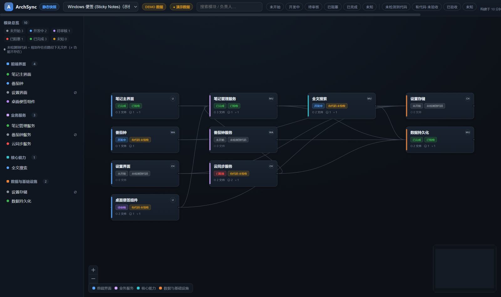

# ArchSync

**ArchSync 是一个面向开发者与 AI Agent 的架构可视化和协作工作台。** 它读取 `.archsync/project.yaml` 中的架构规划，将模块与依赖展示为交互式图谱，并结合文件扫描和 GitHub 协作信息解释项目进度。

[**在线体验 · GitHub Pages**](https://lovezy0730-create.github.io/ArchSync/) · [施工设计](docs/CONSTRUCTION_PLAN.md) · [Pages 部署说明](docs/pages-deploy.md) · [API 文档](docs/api.md)

> **项目版本：v1.0 候选功能集（真实公开 GitHub 数据、自举项目、TS/JS import 依赖分析、快照历史和 Agent CLI）。** 在线网站是否已更新到 v1.0，请以 [最新 main Pages 部署记录](https://github.com/lovezy0730-create/ArchSync/actions) 和网站快照中的 source SHA 为准；PR CI 成功不代表已上线。GitHub Pages 的数据来自**构建时快照**，不是实时同步。



## 立即体验

### 方式一：网页体验（无需安装）

打开 **https://lovezy0730-create.github.io/ArchSync/**。

网页基于 GitHub Pages 免费静态托管，可进行以下操作：

- 浏览 React Flow 分层架构图，缩放、拖拽、适应视图与高亮上下游依赖。
- 搜索、按任务/实现状态筛选模块，点击节点查看路径、负责人、任务关联与证据。
- 查看构建时生成的版本、时间和来源 SHA；识别 **DEMO 数据**与不可用的数据来源。
- 点击「导入 YAML」，在浏览器内解析自己的架构规划并预览；文件**不会上传**，也**不会扫描本机代码**，因此无法确认的实现状态显示为「未知」。

**网页数据来源：** v1.0 默认提供 **ArchSync 自描述项目**（经显式公开允许配置、通过匿名公开 GitHub API 获取 PR/Issue 与文件证据）及 **Windows 便签 (Sticky Notes)** 虚构示例。前者是构建时真实公开数据，后者的成员、Issue、PR 属于 DEMO；具体以当前线上部署版本为准。若 GitHub API 限流，数据会标记 stale / unavailable。

**静态模式边界：** 无 WebSocket 实时光标、服务器端备注编辑、本地文件监听和即时 GitHub 同步。网页展示的是**上一次构建时的数据**，不能将其当作实时 GitHub 状态。

### 方式二：本地完整模式（Windows 11 / macOS / Linux）

环境：Node.js **≥ 22**，项目使用 `pnpm@11.22.0`（可以先执行 `corepack enable`）。

```powershell
git clone https://github.com/lovezy0730-create/ArchSync.git
cd ArchSync
corepack enable
pnpm install --frozen-lockfile
pnpm dev
```

打开 **http://127.0.0.1:4310**。首次启动会构建网页，然后在单端口提供 React 前端、Fastify REST API 与 WebSocket。

本地模式额外支持：

- 实际扫描本仓库或 `examples/*` 项目的 Git 基线与工作区文件，区分规划、实际文件和未提交变更。
- Chokidar 自动监听本地文件以及部分 Git 状态变化，触发本地快照刷新。
- 多浏览器会话的在线成员、光标、选中模块及备注编辑状态。
- 模块备注保存与修订冲突检测；可选只读 GitHub Issues / PR 数据源。

> 默认登录仅是**本机演示身份**，服务仅监听回环地址。它不是公网用户认证，**不要直接把本地开发服务暴露到互联网**。独立的部署鉴权改动如果尚未合并到主线，则不属于上述本地默认版本。

## 两种模式的能力对照

| 能力 | GitHub Pages 静态模式 | 本地完整模式 |
| --- | --- | --- |
| 架构图、详情、搜索、筛选、依赖高亮 | ✅ | ✅ |
| 架构 YAML 导入预览 | ✅ 浏览器内预览 | ✅ 仓库配置解析与校验 |
| Git 文件扫描及本地覆盖层 | — 只有构建时快照 | ✅ |
| GitHub Issues / PR | 构建时公开允许的数据或 DEMO | ✅ 配置只读 Token 后获取 |
| 自动更新 | `main` 更新触发重新构建与发布 | ✅ 本地文件监听；GitHub 状态仍需重新同步 |
| 多人在线光标与模块选中 | — | ✅ 本机多会话 |
| 协作备注写入与冲突检测 | — 只读 | ✅ |
| 需要常驻 Node.js 服务 | 否 | 是 |

## 灵活项目视图

项目可以在 `.archsync/views.yaml` 中定义多个展示视图，例如系统全景、业务流程图和技术分层。视图只决定分组与顺序，不修改模块依赖；未提供该文件时自动回退为层级视图。

```bash
pnpm agent -- layout-context --project archsync
pnpm agent -- layout-validate .archsync/views.yaml --project archsync
```

Agent 只生成可审查的分组与顺序配置，像素坐标由前端布局引擎计算。完整字段、校验规则和交互说明见 [项目视图与灵活布局](docs/project-views.md)。

## 部署方式

两种部署形态均已就绪（实际发布为人工步骤）：

| 形态 | 说明 | 文档 |
|---|---|---|
| **GitHub Pages 静态版**（无后端） | `pnpm build:pages` 生成 /ArchSync/ 子路径静态站；构建时快照 + 公开数据门控 + YAML 本地导入预览 | [docs/pages-deploy.md](docs/pages-deploy.md) |
| **服务器完整版**（Fastify + WS） | 访问码鉴权（`AUTH_CODE`）、`pnpm start`、Dockerfile、`WORKSPACE_ROOT` 挂载扫描 | [docs/deploy.md](docs/deploy.md) |

静态版一键流水线：

```bash
pnpm snapshot:generate   # 构建时快照（只发布 publishStatic: true 的项目）
pnpm build:pages         # /ArchSync/ base 生产构建
pnpm verify:pages        # 产物验证：路径/schema/无 /api·/ws/无凭据
pnpm preview:pages       # 本地预览 http://localhost:4173/ArchSync/
```

服务器完整版：

```bash
export AUTH_CODE='你的访问码'        # ≥8 字符；设置后允许绑定非回环地址
docker compose up -d --build        # http://<服务器IP>:4310
```

安全边界：无访问码且绑定非回环地址时服务拒绝启动；会话 Cookie 为 HttpOnly（`NODE_ENV=production` 时加 Secure）；GitHub 令牌仅存服务端。

## 连接你自己的项目

在仓库根目录或任意子目录放一个 `.archsync/project.yaml`（服务会自动发现根目录与 `examples/*`）：

```yaml
schemaVersion: 1
project:
  id: my-project
  name: 我的项目
  github:
    owner: your-org
    repo: your-repo
    defaultBranch: main
  root: "."
  # 仅在你明确同意整个生成快照被公开时开启：
  # publishStatic: true

layers:
  - { id: ui, label: 界面, order: 1 }
  - { id: service, label: 服务, order: 2 }

modules:
  - id: ui-app
    label: Web UI
    layer: ui
    paths: ["src/ui/**"]
    plannedDependsOn: [api-service]
    issues: [12]

  - id: api-service
    label: API 服务
    layer: service
    paths: ["src/service/**"]
```

本地服务当前会自动发现项目根目录及 `examples/*` 下的配置。配置错误会报告路径、字段及可用的定位信息。

如需在本地服务读取真实 GitHub 协作状态，可将 `.env.example` 复制为 `.env`，使用具有所需**只读权限**的 Token 配置：

```dotenv
GITHUB_TOKEN=YOUR_READ_ONLY_TOKEN
```

不要把真实 Token 提交到 Git。静态 Pages 构建默认**不接受私有 Token**；构建时仅允许 `publishStatic: true` 的项目进入公开产物。真实公开 GitHub 协作数据还需要显式设置 `publishPublicGithubData: true`，否则使用标记过的演示数据或显示不可用。

## GitHub Pages：构建、预览与自动部署

从仓库根目录执行：

```bash
pnpm install --frozen-lockfile
pnpm build:pages       # 生成公开安全的快照并打包静态前端
pnpm verify:pages      # 检查 /ArchSync/ 路径、快照格式与常见凭据泄漏
pnpm preview:pages     # 预览 http://localhost:4173/ArchSync/
```

网页构建输出到 `apps/web/dist`，Vite 使用项目子路径 `/ArchSync/`。

GitHub Actions 工作流 [`.github/workflows/pages-build.yml`](.github/workflows/pages-build.yml) 的行为：

1. 对 PR：运行 lint、类型检查、测试、静态快照、构建、发布结构与安全验证，仅上传**预览 Artifact**；不写历史、不发布线上网站。
2. 对 `main` push、Issue 事件、每周对账或 main 的手动运行：按 `build → archive → deploy` 执行，归档到 `site-snapshots` 历史分支，再发布官方 Pages Artifact。
3. **PR 创建/更新不会直接发布线上快照**；PR 合并触发 main push。静态站显示的只是最近一次成功发布时的数据，非实时 WebSocket。

发布配置与隐私约束见 [GitHub Pages 部署及运维指南](docs/pages-deploy.md)。

## 开发与工程约定

```bash
pnpm lint
pnpm typecheck
pnpm test
pnpm build             # 本地服务模式前端构建
pnpm snapshot:generate # 构建时静态快照
pnpm build:pages
pnpm verify:pages
```

主要目录：

```text
apps/web/              React + React Flow 工作台、双数据提供器
apps/server/           Fastify REST/WS、本地文件监听、静态快照生成器
packages/contracts/    前后端共享 Schema 和类型
packages/config/       YAML 解析与校验
packages/scanner/      Git 文件树与本地工作区扫描
packages/graph/        规划/扫描/协作状态归并
examples/sticky-notes/ 演示项目及明确标记的协作模拟数据
.github/workflows/     CI 与 GitHub Pages 自动构建/发布
```

贡献者和 Coding Agent 请先阅读 [AGENTS.md](AGENTS.md)，使用**独立功能分支、原子化 Conventional Commits、PR 审查与真实测试记录**。

## 当前限制与后续方向

ArchSync 已具备 v1.0 的主要功能，但仍有明确的技术边界，并非完整代码语义分析器或多租户协作平台：

- TS/JS 常见 import 关系可检测并分成已证实/仅规划/代码观察三态；这是**部分分析**，并非完整 AST 调用链或所有语言的语义依赖。
- 静态公开 GitHub 管线在预算内读取真实 Issue、PR、变更文件、提交和状态；本地 token 模式尚未完整支持逐 PR 变更文件；定期对账为每周，PR 未合并事件不会立即上线。
- 静态站点不提供真正的多人实时协作；在线快照展示最新**成功发布的构建**，不等于当前工作区状态。
- 静态 Pages 提供最多近 20 个历史快照和差异对比；本地模式仍以单机 JSON 保存状态，SQLite 多版本历史和多租户身份/权限隔离尚待实现。
- `pnpm archsync:init -- owner/repo` 可对公开仓库生成启发式 YAML 架构建议；`pnpm agent -- snapshot|module|impact|context|validate|report` 提供可审计 Agent CLI。
- Pages 的公开数据安全依赖显式发布允许列表、验证与人工审核；**静态文件一经部署即对所有访问者可见**。

[施工设计](docs/CONSTRUCTION_PLAN.md) · [运行手册](docs/runbook.md) · [API 参考](docs/api.md) · [Pages 发布指南](docs/pages-deploy.md)

---

本项目仍在迭代中。**Pages 静态版可以呈现经允许公开的真实构建时数据，本地完整模式用于实时文件扫描与会话协作；发布版本请以 Actions 和快照 SHA 为准。**
