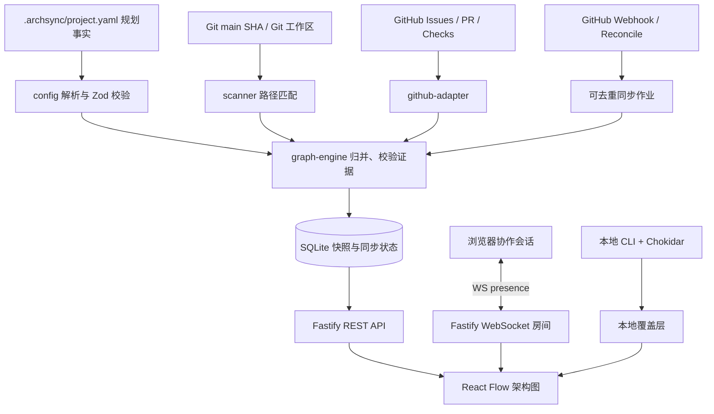

# ArchSync 完整施工文档（MVP v0.1）

> 文档版本：1.0 ｜日期：2026-10-25 ｜状态：待实施（非已实现）  
> 指定 GitHub 仓库：**https://github.com/lovezy0730-create/ArchSync.git**  
> 仓库属主 / 名称：`lovezy0730-create/ArchSync`  
> 默认分支：`main`；2026-10-25 检查时为 **私有、空仓库，无有效提交及分支**。  
> 交付目标：通过功能分支、原子化提交、Pull Request 和自动化测试，逐步交付可运行的多人协作动态架构平台。

## 0. 施工前提与强制约束

本文是交给 **Codex / DeepSeek DSH / 人类开发者** 执行的具体施工标准，不等于项目功能已经完成。凡标记为“应/必须”的内容都是后续开发要求，凡涉及界面、API、数据表的示例均属于设计契约。

### 0.1 仓库真实初始状态与一次性引导

- 已核实仓库 `lovezy0730-create/ArchSync` 存在，访问权限包括写入；可见默认分支名 `main`，但分支列表为空，`contents` 返回 `This repository is empty`。
- **空仓库不能从尚不存在的 `main` 创建功能分支。** 允许一次性在默认分支提交纯初始化 `README.md`（无应用逻辑、无功能代码），使 `main` 成为有效引用。这是全项目唯一允许的主分支直接写入例外。
- 从第二个提交起，任何功能、文档、配置、测试、修复均必须在独立短生命周期分支开发，经 PR 审核后合并；禁止普通开发直接 push 到 `main`。
- 第一次引导结束后，应尽快由仓库管理员在 Settings → Rules → Rulesets 或 Branch protection 为 `main` 设置保护；是否能启用具体规则由当前 GitHub 套餐决定。未验证的保护配置不得宣称已生效。
- 仓库继续保持私有；禁止将真实访问令牌、私有代码内容、会话密钥或运行时数据库提交到 Git。

### 0.2 8 项必须交付的功能

| 编号 | 功能 | MVP 的明确边界 |
|---|---|---|
| FR-01 | 导入架构规划 YAML | 严格校验、可定位错误、稳定模块 ID，支持导入已有本地项目 |
| FR-02 | 交互式架构图 | 分层布局、缩放、点击节点、上下游高亮、状态筛选与证据详情 |
| FR-03 | GitHub 任务状态 | Issues、PR、assignee、review / CI，Projects V2 字段作为增强选项 |
| FR-04 | 文件存在及关联变更 | Git 树/工作区路径匹配、PR 变更文件关联模块；**不声称识别完整函数调用图** |
| FR-05 | 规划与实际分离 | 规划节点/边与实际证据分层，未知 ≠ 不存在，显示偏差与证据 |
| FR-06 | 自动刷新共享快照 | Webhook 触发 + 周期对账 + 原子版本发布 + 失败回退 |
| FR-07 | 本地文件变更监听 | 本机增量扫描和热更新，未提交变化为“本地覆盖层”，不得覆盖团队主线 |
| FR-08 | 团队实时光标/编辑状态 | Web 图内光标、选中节点、架构备注编辑状态、在场信息；IDE 精确光标不在 MVP 内 |

### 0.3 明确暂不实现

- AI 自动重写架构计划、自动合并 PR、自动删除或移动源码、自动给员工打绩效分；
- 多仓库依赖自动拼接、深入 TypeScript/Rust/Tauri 函数级调用分析（仅保留扩展接口）；
- Figma 级多人共同编辑完整架构拓扑、自动冲突合并（首版采用结构化备注字段的乐观锁）；
- 分布式服务、Redis、Neo4j、向量数据库、Kubernetes、完整在线 IDE；
- 在未安装客户端的条件下侦测其他人的本地 IDE 正在编辑哪个文件；
- 默认开放式公网部署和未经验证的开放式团队加入。

### 0.4 交付判断

最小成功场景：两名 GitHub 成员在不同浏览器打开相同项目，均看到同一已发布主线架构快照；一人在 `feat/...` 中更新代码并发 PR，模块关联更新为“开发中/待审核”，但主线文件实现仍来自 `main`；PR 合并后后台重新扫描 `main` 并发布递增版本；两人看到互相的网页光标/选中节点；本地开发者的未提交文件变化只能进入其本机视图。

---

## 1. 产品使用流程与身份定义

### 1.1 角色

- **管理员（admin）**：安装/配置 GitHub App、添加仓库、管理项目设置、分配可编辑权限。
- **维护者（maintainer）**：审核规划 YAML、合并代码 PR、审核关键架构变更。
- **开发者（developer）**：查看架构、编辑带权限的模块备注、启动本地覆盖层、关联 Issue / PR。
- **只读者（viewer）**：查看有权限的快照、详情和在线状态；不能修改持久配置。
- **Agent**：以其操作者身份执行仓库任务，无独立的管理权限；操作必须可审计，不能绕过 GitHub 权限。

### 1.2 真实含义不能混淆

| 字段 | 定义 | 真值来源 |
|---|---|---|
| `owners` | 长期维护责任人 | YAML `owners` 或项目明确指定的团队责任规则 |
| `assignees` | 当前任务执行人 | GitHub Issue Assignee / 可选 Projects 自定义字段 |
| `contributors` | 参与提交/PR 的账户 | GitHub PR/Commit 记录 |
| `implementation` | 实现证据的完整性 | 指定 Git SHA 下路径扫描与验收结果 |
| `workflow` | 任务流程进展 | GitHub Issues、PR、验收配置 |
| `presence` | 网页会话是否在线/正在交互 | WebSocket 最近心跳与客户端声明 |
| `localActivity` | 本机监控到文件变化 | 经授权启用的本地 watcher；不表示“正在键盘输入” |

所有可见状态均显示“来源”“最后同步时间”“数据版本”；当来源未知或失败时必须展示 `unknown` / `stale`，不能猜测完成。

---

## 2. 架构设计与技术选择

### 2.1 总体数据流



### 2.2 选择与理由

| 层 | 技术 | 限制与理由 |
|---|---|---|
| Monorepo | pnpm workspace + TypeScript strict | 统一 contracts，独立构建；锁文件提交仓库 |
| Web | React + Vite + TypeScript | 可嵌入桌面壳但 MVP 只做浏览器版 |
| 图渲染 | `@xyflow/react` + `elkjs` | 可扩展状态节点、证据、交互；稳定布局需缓存节点位置 |
| Server | Node.js LTS + Fastify | API、Webhook、WS 在同一进程，首版单实例 |
| WebSocket | `@fastify/websocket` | 已有 Fastify 插件，Presence 在内存存储 |
| Config | `yaml` + Zod | 执行前输入校验，错误定位 |
| GitHub | Octokit / GitHub App | 安装令牌用于仓库，用户授权用于权限与身份 |
| 本地 Git | 受控 `git` 子进程 + `chokidar` | 只调用固定命令，不执行外部配置或代码；忽略不可信目录 |
| DB | SQLite + `better-sqlite3` + migration | WAL、原子事务、单实例；不可当分布式共享数据库 |
| Tests | Vitest + Playwright | 纯函数、API、双浏览器 E2E |
| 部署 | 本机/单台 HTTPS 服务 | 跨机器实时连接需要持续运行可达服务 |

**依赖版本策略**：建立项目时选取当时稳定且互相兼容的版本，用 `package.json` 与 `pnpm-lock.yaml` 固定；不得从本文臆造“最新”具体版本。`Node.js >= 22`（推荐当前 LTS），使用 Corepack 或独立 pnpm；CI 与开发环境锁定一致的主版本。

### 2.3 单实例第一原则

运行时可以由一个 Fastify 服务同时承载 REST、WebSocket、定时作业和 SQLite；定时作业采用数据库持久化防重复，异步任务在一个进程内排队。部署多个实例之前必须重新设计分布式锁、广播、存储和速率限制；首版**禁止启动多个写入同一个 SQLite 的服务器实例**。

---

## 3. 仓库目录、规范文件与启动命令

```text
ArchSync/
├── .archsync/
│   └── project.yaml                # 用于本仓库自我描述的架构规划
├── .github/
│   ├── workflows/ci.yml
│   ├── pull_request_template.md
│   └── CODEOWNERS                  # 待确认实际协作者再填写
├── apps/
│   ├── web/src/
│   │   ├── app/
│   │   ├── features/graph/
│   │   ├── features/presence/
│   │   ├── features/activity/
│   │   └── lib/api/
│   └── server/
│       ├── src/routes/
│       ├── src/github/
│       ├── src/sync/
│       ├── src/ws/
│       ├── src/auth/
│       └── migrations/
├── packages/
│   ├── contracts/                  # Zod/TS 类型与 API schema
│   ├── config/                     # YAML 验证与投影
│   ├── scanner/                    # 路径匹配、Git 树/文件变化
│   ├── graph/                      # 规划-实现-协作三源合并
│   └── cli/                        # init, scan, dev, check
├── examples/sticky-notes/
├── tests/
│   ├── fixtures/
│   ├── integration/
│   └── e2e/
├── docs/
│   ├── CONSTRUCTION_PLAN.md
│   ├── adr/
│   ├── api.md
│   ├── runbook.md
│   └── acceptance.md
├── AGENTS.md                        # Codex/DSH 所有开发回合必须阅读
├── .env.example
├── .gitignore
├── package.json
├── pnpm-workspace.yaml
└── pnpm-lock.yaml
```

### 3.1 预期 CLI 契约（执行前需先实现，以下命令非现有功能）

```powershell
# 克隆真实指定仓库
git clone https://github.com/lovezy0730-create/ArchSync.git
cd ArchSync

# 初始化项目架构文件（交互式或指定已有项目）
pnpm archsync init

# 扫描 main 中实际文件（只读）
pnpm archsync scan --ref main

# 单人本地实时预览（默认仅监听 127.0.0.1）
pnpm archsync dev

# 检查 YAML 与基础规划一致性，作为 CI 门禁
pnpm archsync check
```

实际脚本必须提供等价 `pnpm --filter @archsync/cli ...` 或根目录 `pnpm archsync ...` 指令；实现后 README 应明确唯一可靠的方式。CLI 每个命令的帮助文本要显示作用范围和是否访问外部网络。

---

## 4. YAML 配置契约（FR-01）

位置：`.archsync/project.yaml`。采用 `schemaVersion: 1`，未知主版本须拒绝；新增字段应向后兼容。源文件是**规划事实唯一权威**；GitHub 动态状态或分析结果绝不反写规划 YAML。

```yaml
schemaVersion: 1
project:
  id: archsync
  name: ArchSync
  github:
    owner: lovezy0730-create
    repo: ArchSync
    defaultBranch: main
  root: "."

layers:
  - id: web
    label: 前端
    order: 1
  - id: api
    label: 接口服务
    order: 2
  - id: core
    label: 分析核心
    order: 3
  - id: infra
    label: 基础设施
    order: 4

modules:
  - id: architecture-view
    label: 架构图界面
    layer: web
    description: 展示规划、实际和人员状态
    owners: []
    paths:
      - apps/web/src/features/graph/**
    issues: []
    plannedDependsOn:
      - snapshot-api
    acceptance:
      requiredIssues: []
      requiredChecks: [lint, typecheck, test, build]
      manualApproval: true

  - id: snapshot-api
    label: 共享快照 API
    layer: api
    description: 提供只读快照和同步任务查询
    owners: []
    paths:
      - apps/server/src/routes/**
    issues: []
    plannedDependsOn: []
    acceptance:
      requiredIssues: []
      requiredChecks: [lint, typecheck, test, build]
      manualApproval: true
```

### 4.1 解析顺序

1. 将 YAML 解析为普通数据结构；限制大小（例如不超过 1 MiB）、层级和节点总数，拒绝自定义标签导致的非预期类型。
2. Zod 做语义校验：`project.id`、`module.id` 满足 `^[a-z][a-z0-9-]{1,63}$`；ID 项目内唯一；layer 必须已定义；依赖目标必须存在；自依赖禁止；重复边去重。
3. `paths` 必须是相对于仓库根的 POSIX `/` 路径 glob；拒绝绝对路径、`..`、NUL、路径越界和不支持的高级模式；严禁跟随指向仓库外的符号链接。
4. `issues` 只能为正整数；`owners` 使用 GitHub login；`requiredChecks` 为明确 CI job 名称；`manualApproval` 必须在 UI 中有可追踪的授权记录。
5. 环形依赖**警告但不直接拒绝**，因为现实架构有时允许环；图谱可视化要标明循环。
6. 错误返回 `path`、`code`、`message` 和可定位行列（若 YAML 解析器能提供），非法配置不能覆盖最后成功快照。

### 4.2 规划配置的编辑协议

MVP 的模块结构（新增节点、依赖、路径）必须通过 Git 分支+PR 修改 YAML。网页只允许编辑独立的**协作备注和显示偏好**；若未来开放浏览器修改 YAML，必须生成提议补丁/PR，不绕过代码审查。

---

## 5. 共享 TypeScript 数据契约与语义（FR-04/05）

`packages/contracts` 中定义 Zod schema 并从 schema 推断类型；前后端不得复制定义。以下是规范化业务形态，具体代码以同等校验的实现为准：

```ts
export type ImplementationState =
  | 'not_detected'         // 扫描成功且本模块零匹配文件
  | 'detected_unverified'  // 匹配到文件，未具备完整验收证据
  | 'verified'             // 必须条件全部满足且针对正确 SHA
  | 'unknown';            // 尚未扫描/数据不可用

export type WorkflowState =
  | 'not_started' | 'in_progress' | 'in_review'
  | 'blocked' | 'done' | 'unknown';

export type DependencyEvidenceState =
  | 'planned_only' | 'observed' | 'unassessed' | 'conflict';

export type EvidenceSource =
  | 'yaml' | 'git-tree' | 'github-issue' | 'github-pr'
  | 'github-check' | 'manual-acceptance' | 'local-watch';

export interface Evidence {
  source: EvidenceSource;
  ref: string;            // 相对路径、Issue URL、PR URL、SHA 等
  revision?: string;
  observedAt: string;     // ISO-8601 UTC
  details?: Record<string, string | number | boolean>;
}

export interface ModuleState {
  id: string;
  label: string;
  layer: string;
  plannedPaths: string[];
  plannedDependsOn: string[];
  matchedPaths: string[];
  observedDependsOn: string[] | null; // null = 未进行依赖解析
  implementation: ImplementationState;
  workflow: WorkflowState;
  owners: string[];
  assignees: string[];
  contributors: string[];
  issueNumbers: number[];
  pullRequestNumbers: number[];
  evidence: Evidence[];
  warnings: string[];
}

export interface Snapshot {
  id: string;
  projectId: string;
  version: number;          // 单项目严格递增，事务中赋值
  branch: string;           // 共享快照固定 main
  sourceCommitSha: string;
  configBlobSha: string;
  githubFetchedAt: string | null;
  generatedAt: string;
  freshness: 'fresh' | 'stale';
  scanCompleteness: 'complete' | 'partial' | 'unknown';
  dependencyAnalysis: 'not_supported' | 'partial' | 'complete';
  modules: ModuleState[];
  edges: Array<{
    id: string;
    source: string;
    target: string;
    kind: 'planned' | 'observed';
    evidence: Evidence[];
  }>;
  warnings: string[];
}
```

### 5.1 状态判定矩阵（纯函数、必须单测）

- 文件扫描未成功 → `implementation=unknown`，**不允许输出 not_detected**。
- 文件扫描成功、零匹配 → `not_detected`。这仅说明约定路径没有匹配文件，不证明功能不存在。
- 有匹配文件，但无匹配 SHA 的验收条件 → `detected_unverified`。
- 必需 Issue 全部以 `completed` 关闭、必需 CI 检查针对目标 commit 成功、人工验收（若启用）由授权维护者确认 → 可以判 `verified`。任何证据不齐 → `detected_unverified`；配置无足够验收标准时不能自动 `verified`。
- `workflow=blocked` 仅来自显式 `status:blocked` 字段/标签或团队约定；不能凭测试失败推断人员正在被阻塞。
- 有非 Draft 的开放 PR → `in_review`；只有 Draft PR 或显式进度字段 → `in_progress`；任务符合验收规则 → `done`；否则按 Issue/Projects 状态判断；多个矛盾来源以 `unknown` + 警告处理，而不是随意挑一个。
- 一模块同时关联多个任务，明确声明 `requiredIssues` 的集合是验收要求，其他 Issue 只是关联；不能用“有一个完成了”推断整个模块完成。
- `contributors` 来自 GitHub PR/Commit 元数据；不等同 `owners` 或 `assignees`。
- 如果本轮 GitHub API 失败，保持最后一次成功的动态数据，整体 `freshness=stale`，带来源更新时间；不能清空贡献者和任务列表。

### 5.2 图谱状态表现

- 计划中的节点和边可用淡色或虚线绘制；扫描到的文件/模块增加实体标记；依赖仅有“计划”时不得绘制成已验证调用链。
- MVP 不进行 AST 解析时，`observedDependsOn=null` 与 `dependencyAnalysis=not_supported` 是正确结果，而不是 `[]`。
- 有代码但 YAML 没规划映射：放入“未归类变更”列表，不擅自创建业务节点。
- UI 为每个节点提供四个标签：实现、任务、负责人/任务执行者、证据新鲜度。
- 点击节点显示规划路径、匹配文件、关联 Issue/PR、证据、与主线版本，提供跳转仓库文件的 GitHub 链接。

---
## 6. 文件扫描、关联变更与本地覆盖层（FR-04/07）

### 6.1 Git 主线扫描

输入必须含 `repositoryId` + **完整 40 位 `commitSha`** + 校验后的配置。不得将不稳定分支名直接当作扫描过程中的一致性标识。

1. 获取指定 commit 的 Git tree（递归，处理 GitHub 返回的 `truncated`）；对受限大小的项目也可 clone 后用 `git ls-tree -r --name-only <sha>`。
2. 标准化路径为 POSIX `/`，对模块 `paths` 做 glob 匹配，生成 `matchedPaths`；同一文件可属于多个模块，记录交叠告警。
3. 显式忽略 `.git/`、`node_modules/`、`dist/`、`.next/`、`.archsync/cache/`、大体积二进制/生成文件（可配置）。
4. PR 变更从 GitHub `pulls/{id}/files` 的分页结果取得，包含旧路径 `previous_filename` 处理重命名；根据 glob 将变更映射到候选模块。不能仅凭 PR 标题提取。
5. 保留证据 `(repository, commitSha, path, PR number)`；同一文件被多个模块匹配时展示“多模块关联”而不是任选一个。
6. 首版只判文件存在及变更文件关联；若遇到依赖超出当前能力，返回 `unassessed`，不得伪造 AST 结果。

### 6.2 本地扫描与 watcher

- `archsync dev` 在工作站启动仅监听回环地址的本地预览服务，使用 `chokidar` 监听有效代码目录。可在启动时扫描并监听新增/删除/重命名，变化事件按 500ms 左右防抖、聚合，再按受影响模块重新计算。
- 本地状态必须带 `overlay=local`、`workspaceHeadSha` 和 `dirtyPaths`，明确显示“未提交”。**本地覆盖层与远端主线 Snapshot 永远分别持有**。
- 本地数据默认不上传，远端共享架构只使用 GitHub 已授权仓库的主线/PR 数据。用户明确开启“共享本地活动”时，只上传文件路径、模块 ID、活动时间和会话 ID，不上传文件内容。
- 忽略无关变化（`.git/`、`node_modules/`、`dist/`、`.env*`、凭据、缓存）；防止软链接、路径逃逸及压缩包解压炸弹。避免自动执行工作区脚本，防止未经信任仓库的任意命令执行。
- 若在监听期间远端 `main` 更新，本地视图呈现“基线更新可用”，让用户主动刷新或按安全逻辑切换；不得覆盖工作区用户修改。

### 6.3 模块和 PR 关联算法

算法优先级：显式 Issue→模块映射 > PR 关闭/关联 Issue > 变更路径匹配 > 人工确认。输出 `confidence` 与 `reasons`；**路径关联是候选关系，不等于业务负责人确权**。

示例返回：

```json
{
  "pullRequest": 42,
  "candidateModules": [
    {
      "moduleId": "architecture-view",
      "association": "changed_paths",
      "matchedPaths": ["apps/web/src/features/graph/GraphCanvas.tsx"],
      "needsReview": false
    }
  ]
}
```

---

## 7. GitHub 认证、事件同步和共享快照（FR-03/06）

### 7.1 身份与权限方案

- **生产方案**：GitHub App 安装在目标仓库，Installation Token 读取 Repository Contents、Issues、Pull requests、Checks/Actions（按最小权限精确配置）；用户通过 GitHub 授权流程登录，并在服务端逐次或按短 TTL 检查其目标仓库访问权限。
- 不得把 Installation Token、GitHub App 私钥、用户 access token 或 session cookie 内容发往浏览器 JS。Cookie `HttpOnly; Secure; SameSite=Lax/Strict`；跨站请求需 CSRF 防护和明确 CORS allowlist。
- 本机离线演示允许显式 `DEV_AUTH_MODE=mock` 和固定的 demo 用户，**仅限 `127.0.0.1`**；只要监听非回环地址或生产环境就必须禁用 mock auth。
- WebSocket 握手继承认证会话并检查仓库权限、Origin 和 projectId；断线重连需要重新授权，不允许客户端自己指定 `userId` 当作可信身份。
- GitHub App 安装范围最小化为指定仓库；未来团队多租户后再扩展。Projects V2 GraphQL 的权限并不等同普通 Issues：若无权限就标为 `projectsUnavailable` 并退化到 Issue/PR 路径。

### 7.2 触发清单

| 触发 | 动作 | 幂等键 |
|---|---|---|
| `push` 到默认分支 | 拉取最新 HEAD + 规划 YAML + Git 树、重建 | repoId + head SHA |
| `issues`（opened/edited/assigned/unassigned/closed/reopened/labeled 等） | 刷新 Issue 投影，再重建动态状态 | GitHub delivery ID |
| `pull_request`（opened/synchronize/ready_for_review/closed 等） | 查询 PR 元数据及全部变更文件，刷新候选模块 | GitHub delivery ID |
| `check_run` / `check_suite` | 刷新相应 commit 检查状态 | GitHub delivery ID |
| Projects V2 更新（若已开通并取得权限） | 更新自定义状态字段并关联 Issue | GitHub delivery ID |
| 定期 reconcile | 按最后已知状态重新查询并校验差异 | repoId + window + scope |
| 本地文件变化 | 只重建本机 overlay，不发布 main 快照 | workspace + changedPath + debounce batch |

Webhooks 是**触发重查**的提示，不是可以直接完全信任的数据镜像：验签、去重后仍需重新查询 GitHub 当前状态。先实现核心事件，额外事件按需加；未知事件返回成功但不更新。

### 7.3 Webhook 安全与错误恢复

1. 入口保存原始 request bytes；用 `X-Hub-Signature-256` 与密钥计算 HMAC-SHA256，以常量时间比较；无效签名返回 `401`，不入库。
2. `X-GitHub-Delivery` 唯一索引去重，记录事件类型、仓库、处理状态及接收时间；重复投递返回 `202` 并保持幂等。
3. 验签后仅将**最小必要信息**写入作业队列，响应 `202`；复杂同步在后台队列处理，附日志和指数退避重试。
4. 对 API `403`/rate limit、`429`、`5xx`、超时进行分类；遵循 `Retry-After` 和速率限制头，不要并发无限重试。
5. 任何同步失败均不得覆盖最后成功快照；展示 `stale`、错误码、最后成功同步时间，管理员可以手动重试。
6. 每 5–15 分钟（可配置）对活跃项目做一次同步对账；这一周期是产品约定的最终一致性上界目标，而不是服务可用性保证。
7. 同一项目只允许一个发布作业提交快照版本，较旧 SHA 的结果不得覆盖较新 SHA 的共享基线；对于同 SHA 的 Issue/PR 变化允许发布新的递增快照。

### 7.4 快照发布事务与版本

- 构建新 Snapshot 时绑定 `main` 完整 SHA 和 config blob SHA。若重建过程主分支 HEAD 发生变化，完成后要重查 HEAD；若已过期则丢弃或仅记录历史，不能将旧版本发布为“当前”。
- `snapshots` 采用 append-only；事务内插入 snapshot + 将 `projects.current_snapshot_id` 指向它 + 递增 `version`，**最后**推送 `snapshot.published` WS 事件。
- 浏览器收到事件后 REST GET 对应快照，比较 `version`，仅替换更高版本。首次连接或 WS 重连必须 GET 最新版本以补偿事件丢失；使用 ETag / If-None-Match 优化。
- 主线实施结果、PR 草稿变更、用户本地未提交覆盖层都属于不同作用域，不可合并成同一“真实文件已存在”状态。

### 7.5 PR 工作流与完成定义

`PR merged` 是“代码进入基线”，不是“功能已验收”。状态 `done` 必须满足模块配置的必需 Issue 状态、对应 commit 的必需检查及维护者的显式验收（如配置要求）。PR 已合并但 Issue 未关闭时继续显示“待验收/未完成”，并给出来源链接。

---

## 8. 实时协作 Presence 与备注编辑（FR-08）

### 8.1 目标体验

- 两个不同 GitHub 账号打开同一项目：能看到对方的昵称、颜色、架构画布光标、正在查看的模块；选中某节点时其他成员看到头像标记。
- 进入“备注编辑”输入框后广播 `editingField=annotation`；离开输入框、会话断开或 TTL 超时取消编辑标记。
- **团队成员的 IDE 编辑状态** 不作为 MVP 的强真实性能力；本地 watcher 只能上传经允许的变更活动，UI 标为“本地文件发生变化”，不标为“XX 正在编辑第 N 行”。
- 光标与编辑状态是易失信息，**不写入共享持久快照，不记录光标历史**；仅保存需要追溯的备注修订日志。

### 8.2 WS 消息封装

所有 WS 消息使用以下统一外壳，服务端依会话身份填充/覆盖 `actorId`，不得信任客户端传来的身份。

```ts
type WsEnvelope<T> = {
  type: string;
  requestId?: string;
  projectId: string;
  seq?: number;
  sentAt: string;
  payload: T;
};
```

| 方向 | 类型 | 核心字段 |
|---|---|---|
| C→S | `presence.update` | `{ cursor?: { x,y }, selectedModuleId?, mode, editingField? }` |
| C→S | `presence.ping` | `{}` |
| S→C | `presence.roster` | `{ participants: [...] }`，建立连接/重连后 |
| S→C | `presence.changed` | `{ actorId, sessionId, cursor?, selectedModuleId?, mode }` |
| S→C | `presence.left` | `{ sessionId }` |
| S→C | `snapshot.published` | `{ snapshotId, version }` |
| S→C | `server.error` | `{ code, message, requestId? }` |

- 坐标是 **React Flow 画布坐标**，不是屏幕或浏览器窗口坐标，客户端负责视口变换；非法坐标、NaN、无限大、越界值都必须拒绝。
- 同一用户多个标签页用不同 `sessionId`；UI 可以聚合相同用户的头像，但仍对会话独立超时。
- 单会话每秒最多 10 次光标更新；服务器按客户端/房间限流，消息大小上限建议 8 KiB；光标变化可丢弃中间帧，快照发布事件不可依赖单次推送保证到达。
- 心跳间隔 15s，45s 未收到有效活动即判定离线并广播离开；断线使用带抖动的指数退避重连。
- 同一项目有多房间时 room key 为经权限检验的内部 `projectId`，禁止用户自行加入任意仓库房间。

### 8.3 备注保存与并发冲突

`PATCH /api/v1/projects/:id/modules/:moduleId/annotation`：

```json
{
  "text": "这里的 IPC 参数待统一",
  "expectedRevision": 4
}
```

事务中校验授权、长度、纯文本清洗及 `expectedRevision`；一致则修订版本 `+1` 返回 `200`，否则 `409 annotation_conflict` 并返回最新 revision 与正文（只对有访问权限者）。禁止 last-write-wins 静默覆盖。第一版只编辑备注，不直接在多人网页里改 YAML 拓扑结构。

---

## 9. REST API 合约

路径前缀：`/api/v1`，统一返回 JSON，时间均用 ISO-8601 UTC；响应错误：`{error:{code,message,requestId,details?}}`。任何包含私有仓库元数据的响应均需权限检查，不因使用 UUID 就跳过 ACL。

| 方法 | URL | 授权 | 返回/约束 |
|---|---|---|---|
| GET | `/healthz` | 无 | 存活探针，不含仓库敏感信息 |
| GET | `/api/v1/me` | 用户 | 当前用户/授权仓库摘要 |
| GET | `/api/v1/projects` | 用户 | 仅可访问的项目列表 |
| GET | `/api/v1/projects/:id/snapshot` | viewer+ | 当前 Snapshot + `ETag`；支持 `?version=` 查看历史 |
| GET | `/api/v1/projects/:id/modules/:moduleId` | viewer+ | 模块状态、证据、路径、Issue、PR、备注 |
| GET | `/api/v1/projects/:id/activity` | viewer+ | 分页事件摘要，不泄露令牌/代码内容 |
| POST | `/api/v1/projects/:id/config/validate` | developer+ | 校验 YAML 文本，结果不落主线配置 |
| POST | `/api/v1/projects/:id/sync` | maintainer+ | 幂等入队、202 `{jobId}`，需审计 |
| GET | `/api/v1/jobs/:jobId` | 对应项目 viewer+ | `{state,createdAt,finishedAt,error?}` |
| PATCH | `/api/v1/projects/:id/modules/:moduleId/annotation` | developer+ | 带 `expectedRevision` 乐观锁 |
| POST | `/api/v1/webhooks/github` | GitHub 签名 | 验证原始 body 与 Delivery ID；`202` |
| WS | `/ws?projectId=:id` | 需会话/仓库授权 | WS 封装协议，校验 Origin / 房间 |

### 9.1 服务端权限边界

- `GET snapshot` 不允许把本地未提交路径、私有工作目录全路径暴露给其他成员；源文件路径只显示相对于仓库根的内容。
- 同一用户在 GitHub 仓库权限撤销后，下一次敏感请求须拒绝，现存 WS 会话应在有限时间内失效；允许基于短 TTL 缓存但不能永久授权。
- `POST sync` 要限流；`POST webhook` 只接受固定 GitHub Webhook Host/签名，不因为伪造来源 IP 就跳过验签。
- 前端每个项目应绑定明确仓库，不从用户传入的 URL 去请求任意网络地址（防 SSRF）。

---

## 10. SQLite 逻辑数据库

迁移脚本在 `apps/server/migrations/`，所有 schema 更改必须有向前迁移和测试；生产 DB 不入仓库，采用 WAL 模式；备份应保持 SQLite 一致性（在线 backup API 或协调事务），不直接无约束复制数据库文件。

```sql
CREATE TABLE projects (
  id TEXT PRIMARY KEY,
  repository_full_name TEXT NOT NULL UNIQUE,
  default_branch TEXT NOT NULL,
  current_snapshot_id TEXT,
  next_snapshot_version INTEGER NOT NULL DEFAULT 1,
  created_at TEXT NOT NULL,
  updated_at TEXT NOT NULL
);

CREATE TABLE snapshots (
  id TEXT PRIMARY KEY,
  project_id TEXT NOT NULL REFERENCES projects(id),
  version INTEGER NOT NULL,
  source_commit_sha TEXT NOT NULL,
  config_blob_sha TEXT NOT NULL,
  generated_at TEXT NOT NULL,
  github_fetched_at TEXT,
  freshness TEXT NOT NULL,
  payload_json TEXT NOT NULL,
  UNIQUE(project_id,version)
);
CREATE INDEX idx_snapshots_project_version
  ON snapshots(project_id,version DESC);

CREATE TABLE sync_jobs (
  id TEXT PRIMARY KEY,
  project_id TEXT NOT NULL REFERENCES projects(id),
  kind TEXT NOT NULL,
  dedupe_key TEXT NOT NULL,
  state TEXT NOT NULL,
  attempt INTEGER NOT NULL DEFAULT 0,
  error_code TEXT,
  created_at TEXT NOT NULL,
  updated_at TEXT NOT NULL
);
CREATE INDEX idx_jobs_project_state ON sync_jobs(project_id,state);

CREATE TABLE webhook_deliveries (
  delivery_id TEXT PRIMARY KEY,
  project_id TEXT,
  event_type TEXT NOT NULL,
  received_at TEXT NOT NULL,
  processed_at TEXT,
  state TEXT NOT NULL
);

CREATE TABLE module_annotations (
  project_id TEXT NOT NULL REFERENCES projects(id),
  module_id TEXT NOT NULL,
  text TEXT NOT NULL,
  revision INTEGER NOT NULL DEFAULT 1,
  updated_by TEXT NOT NULL,
  updated_at TEXT NOT NULL,
  PRIMARY KEY(project_id,module_id)
);

CREATE TABLE annotation_revisions (
  project_id TEXT NOT NULL,
  module_id TEXT NOT NULL,  revision INTEGER NOT NULL,
  text TEXT NOT NULL,
  author_login TEXT NOT NULL,
  created_at TEXT NOT NULL,
  PRIMARY KEY(project_id,module_id,revision)
);
```

如需存储 GitHub App 安装 ID、用户会话信息等，另写 migration 并保证令牌加密或只在运行时保留；不把用户的 token 原文插入 `payload_json`。实时 `presence` 留在进程内的 `Map<projectId, Map<sessionId,Presence>>`，不进 DB。

---
## 11. 功能分支、原子化提交与 PR 制度（强制）

### 11.1 分支拓扑

```text
main                                    # 只接受经审查的 PR
├── docs/ARCH-000-construction-plan     # 施工文档（本次交付）
├── chore/ARCH-001-workspace            # 基础工程
├── feat/ARCH-002-config-contracts     # 配置与共享契约
├── feat/ARCH-003-graph-ui             # 架构可视化
├── feat/ARCH-004-scanner              # 扫描器
├── feat/ARCH-005-github-sync          # GitHub 数据适配
├── feat/ARCH-006-snapshots            # 快照与持久化
├── feat/ARCH-007-local-watch          # 本地监听
├── feat/ARCH-008-presence             # 身份 + 实时光标
└── test/ARCH-009-acceptance            # E2E 与稳定性
```

`ARCH-xxx` 是**施工任务编号**，不是已经存在的 GitHub Issue 号码；正式建立 Issue 时在 PR 中补充实际 `#NN`，不可伪造 Issue 链接。

### 11.2 创建分支与工作树

```powershell
# 主仓库：始终从远端 main 最新点派生
git fetch origin
git switch main
git pull --ff-only origin main
git switch -c feat/ARCH-003-graph-ui

# 或供多个 Agent 并行：使用隔离的工作树
git fetch origin
git worktree add ../ArchSync-graph -b feat/ARCH-003-graph-ui origin/main
# 另一个 Agent 在其他工作树，不共享未提交文件
```

Git worktree 可并行使用相同仓库的不同分支，但不得让两个 Agent 同时在同一工作树修改相同文件；每个 Agent 必须独立安装依赖或使用安全共享缓存。

### 11.3 原子提交定义与做法

一个提交必须满足：**单一逻辑目的、可独立解释、可验证、可回滚**。不要求“一文件一个提交”，也不能把“功能、重构、文档格式化、测试修复”混成一次巨大提交。优先先写失败测试，再实现，再重构，按功能单元提交。

**推荐提交格式：Conventional Commits**

```text
feat(graph): highlight upstream and downstream dependencies
fix(scanner): normalize renamed paths before module matching
test(presence): cover session expiry after lost heartbeat
refactor(contracts): centralize snapshot state schemas
docs(workflow): document branch and PR requirements
chore(ci): add workspace build verification
```

```powershell
# 务必先检查差异
git status --short
git diff --check
git diff

# 只暂存当前逻辑变更；若改动混合，采用交互式暂存
git add -p
# Windows PowerShell 默认同样可用 git add -p
git diff --cached --check
git diff --cached

# 运行与该提交相关的目标测试后再提交
git commit -m "feat(graph): highlight related modules"

# 继续第二个独立逻辑单元
git add apps/web/src/features/graph/GraphDetails.tsx
# 先运行必要测试
git commit -m "test(graph): verify dependency highlighting"
```

若需要同时变更契约和消费方，提交应保证中间步骤仍可构建（或有明确的预备兼容提交）；不可先提交破坏所有消费者的 API 再等待另一 Agent 修复。自动生成代码/锁文件与对应源码一起提交，禁止独立无意义的大范围格式化。

### 11.4 PR 规则与合并策略

1. 一项功能/一个关注点一个短生命周期分支；不在一个 PR 内夹带不相关功能。
2. Draft PR 可以尽早建立，正文链接施工包编号与 Issue（实际存在时）。
3. PR 正文必须包含：目标、模块、设计变化、提交列表、验收证据、测试**真实输出**、截图（UI 时）、安全影响、未完成项与回滚方案。
4. CI 必须运行并通过 `lint`、`typecheck`、`test`、`build`；有 UI 或安全相关改动时还应跑 Playwright/安全测试。
5. 生产功能 PR 至少由非作者的维护者审批；如果项目临时只有一个人，记录单人豁免原因和自检证据，不能虚构第二个审阅者。
6. 禁止自动合并未审核代码；`main` 禁止 force push、禁止删除，禁止直接推功能提交。优先**Rebase and merge**，保留分支内多个原子提交到主线；不默认使用 Squash（会把多次原子提交压为一次），不要在 `main` 上 cherry-pick 未审查的变更。
7. 合并后的 CI 与基本冒烟测试必须通过；发现回归应使用 `revert` 新提交和新 PR，而不是重写历史。
8. 建议常规 PR 只覆盖一个子系统、便于在 30 分钟内完成审阅；代码量超出可审查范围时拆成更小的前置 PR，不机械设定绝对行数上限。

### 11.5 主分支保护期望值

在 `main` 初始化后由管理员手动开启（不假装脚本已设置）：禁止 force push 与删除；必须 PR 合并；需要至少 1 个审阅（有两名及以上协作者时）；必需检查 `lint`/`typecheck`/`test`/`build`；要求 resolved conversations；视可用性开启线性历史和管理员禁止绕过。**先等 CI 工作流真正运行并显示检查名，再设为必需，否则可能把主分支锁死。**

### 11.6 分支/Agent 交互顺序

- P0 契约未稳定前不要同时开发多个相互依赖子系统。
- 只有 `packages/contracts` 的指定负责人可以修改共享 schema；其他 Agent 遇到契约缺口应先提交 Issue/ADR，不得私改共享类型。
- UI、扫描器、GitHub adapter 可在 contracts 合并后并行。集成工作在单独分支进行，统一通过 PR，不允许一个 Agent 偷偷修改另一个 worktree。
- 每次开始工作：`git fetch` → 检查未提交改动 → 阅读 `AGENTS.md` 和本文件 → 明确本次任务 → 切分支 → 编写测试 → 最小实现 → 验证 → 原子提交 → 推送 → PR。
- 每次结束：报告分支、commit 短 SHA、PR URL、测试命令与结果、剩余阻塞；无证据不得声称完成。

---

## 12. 施工任务包、依赖和原子提交蓝图

估计为有效人日（非承诺工期），以一名熟悉 TypeScript 的工程师配合 Agent、具备正常 GitHub 访问为前提。每阶段需通过门禁后再开始依赖任务。

| 任务包 | 分支名 | 依赖 | 关键产物 | 估算 |
|---|---|---|---|---|
| ARCH-000 | `docs/ARCH-000-construction-plan` | 引导提交 | 本施工书、AGENTS.md、PR 模板 | 0.5–1d |
| ARCH-001 | `chore/ARCH-001-workspace` | ARCH-000 | pnpm workspace、strict TS、lint/test/build、CI | 1–2d |
| ARCH-002 | `feat/ARCH-002-config-contracts` | ARCH-001 | Zod schema、YAML parser、样例与校验器 | 2–3d |
| ARCH-003 | `feat/ARCH-003-graph-ui` | ARCH-002 | React Flow、ELK、节点详情、筛选/高亮 | 3–5d |
| ARCH-004 | `feat/ARCH-004-scanner` | ARCH-002 | SHA 树扫描、路径关联、PR 变更映射 | 3–4d |
| ARCH-005 | `feat/ARCH-005-github-sync` | ARCH-002 | GitHub App 连接、Issue/PR/Checks、Webhook | 4–6d |
| ARCH-006 | `feat/ARCH-006-snapshots` | ARCH-004,005 | SQLite migration、合并器、任务、版本发布 | 3–5d |
| ARCH-007 | `feat/ARCH-007-local-watch` | ARCH-004,003 | Chokidar、本地 overlay、增量热更新 | 2–3d |
| ARCH-008 | `feat/ARCH-008-presence` | ARCH-003,005（认证底座） | 授权 WS、光标/选中、心跳、备注乐观锁 | 3–5d |
| ARCH-009 | `test/ARCH-009-acceptance` | ARCH-006,007,008 | Playwright 双浏览器、恢复、安全与负载检查 | 2–4d |

**总计粗估 23–38 人日**（包括集成返工预留前的初步实现量；需另考虑部署环境和安全复核）。并行不是所有 Agent 同时启动：最适宜的并行窗口是 ARCH-002 合并后的 ARCH-003/004/005；ARCH-006/008 再按接口依赖顺序集成。

### ARCH-001：基础仓库和 CI

**施工步骤**：workspace 文件和 package scopes → ESLint/Prettier/TS strict → 根脚本 → Vitest 冒烟 → Vite/Fastify 空页面 → GitHub Actions。首次 PR 在 CI 上跑完整命令，不编写虚假的 workflow 成功徽章。

原子提交建议：

1. `chore(workspace): initialize pnpm monorepo and scripts`
2. `chore(tooling): add strict TypeScript and lint settings`
3. `test(workspace): add package smoke tests`
4. `ci: verify lint typecheck test and build on pull requests`

**验收**：新机器 clone 后 `pnpm install --frozen-lockfile`、`pnpm lint`、`pnpm typecheck`、`pnpm test`、`pnpm build` 成功；启动 API 健康检查和 Web 空页；CI 状态可在 PR 查看。

### ARCH-002：契约和 YAML

施工步骤：实现 Types/Zod → parser 与定位错误 → YAML fixture 正反例 → 规划边生成 → `check` 命令。没有完成这一任务前，禁止其他 Agent 发明不同的 `workflowState` 字段。

原子提交建议：

1. `feat(contracts): define plan and snapshot schemas`
2. `feat(config): parse and validate architecture yaml`
3. `test(config): reject invalid IDs and unsafe paths`
4. `feat(cli): add architecture config check command`

**验收**：10 节点 / 15 规划边可解析；重复 ID、悬空依赖、越界路径被拒；错误信息可定位；输出是确定性的；单测覆盖主要边界。

### ARCH-003：图形交互

施工步骤：GraphCanvas 基础布局 → 自定义节点（规划/实际/任务）→ 筛选与上/下游 BFS 高亮 → ModuleDrawer → 视口和节点位置缓存 → 访问性支持。

原子提交建议：

1. `feat(graph): render layered architecture with ELK`
2. `feat(graph): highlight dependency paths on selection`
3. `feat(graph): show module status and evidence drawer`
4. `test(graph): cover selection filters and stable layout`

**验收**：10–30 个模块仍能读清方向；点击节点看到祖先/后继；规划与真实边明显不同；刷新后保持视图设置；未知状态不被画成已完成；键盘可以选择和关闭详情。

### ARCH-004：扫描器

施工步骤：获取文件列表（指定 SHA）→ glob 匹配 → GitHub PR diff/文件映射 → 重命名处理 → 来源证据 → Git 失败处理。禁止执行来自仓库的应用代码。

原子提交建议：

1. `feat(scanner): map git tree paths to module globs`
2. `feat(scanner): associate PR changed files with modules`
3. `test(scanner): cover renames overlaps and partial scans`

**验收**：检测删除/新增/重命名；一文件映射多模块可解释；扫描部分失败时输出 unknown 而非不存在；适用于 Windows 路径规范化。

### ARCH-005：GitHub 与认证

施工步骤：GitHub App 连接（安装令牌/用户会话）→ Issues/PR 读取及分页 → 检查状态 → Webhook 验签与去重 → 同步任务入队 → 权限测试。无权限 Projects 字段要显式降级。

原子提交建议：

1. `feat(auth): add GitHub user session and repository ACL`
2. `feat(github): fetch issues PRs and check results`
3. `feat(webhook): verify signatures and dedupe deliveries`
4. `test(github): cover pagination rate limits and ACL denial`

**验收**：两账号访问私有仓库权限正确；过期令牌安全失败；Webhook 错误签名 401；重复投递不重复执行；有 API 限额时显示 stale。

### ARCH-006：主线快照与发布

施工步骤：SQLite migration → 三源合并状态纯函数 → 同一项目串行任务 → 主线 SHA 抗乱序保护 → Snapshot API → WS 发布通知 / 失败保持旧版本。

原子提交建议：

1. `feat(store): create snapshot and job migrations`
2. `feat(sync): merge plan scan and GitHub status`
3. `feat(sync): publish snapshots transactionally`
4. `test(sync): prevent stale job overwriting current head`

**验收**：同一主线 SHA 的不同 Issue 状态可产生递增版本；旧 Job 不覆盖新 Job；失败原快照仍在；两个浏览器 GET 结果一致。

### ARCH-007：本地监听

施工步骤：CLI dev 本地服务 → chokidar → 防抖 / ignore → overlay → 前端主线与本地叠加区分 → Watcher 崩溃恢复。

原子提交建议：

1. `feat(watch): track local workspace file changes`
2. `feat(overlay): mark uncommitted file activity in UI`
3. `test(watch): debounce bursts and ignore private files`

**验收**：新增、删除、重命名在本地 UI 快速可见；没有提交不会影响远端共享 Snapshot；`.env` 与 `node_modules` 不触发发送。

### ARCH-008：实时协作

施工步骤：WS 鉴权/房间 → 心跳和身份 → 10Hz 光标和选中节点 → 编辑声明 → 备注 PATCH 版本冲突 → 断线重连 / TTL。

原子提交建议：

1. `feat(presence): authorize project websocket sessions`
2. `feat(presence): broadcast cursors and selections`
3. `feat(annotations): save notes with revision checks`
4. `test(presence): expire sessions and reject cross-room access`

**验收**：两个不同账号在不同浏览器同时看到光标；不允许跨仓库窃听；45s 内清除断开的会话；同字段冲突返回 409；浏览器外的 IDE 编辑不被误标。

### ARCH-009：最终验收与交付

施工步骤：真实仓库/模拟 GitHub API 分离的测试 → Playwright E2E → 错误恢复 → Windows/Ubuntu 启动说明 → runbook/ADR → 演示视频或截图。

原子提交建议：

1. `test(e2e): cover cross-account presence and snapshot refresh`
2. `test(recovery): cover webhook duplication and disconnects`
3. `docs(runbook): document deployment backups and recovery`

**验收**：第 13 节全部 P0 必选用例通过；任何环境依赖限制按真实情况记录；部署说明可从空机器复现。

---

## 13. 验收测试用例矩阵

| ID | 级别 | 预置场景 | 通过条件 |
|---|---|---|---|
| T01 | unit | 10 模块 15 规划边的 YAML | 节点/边准确、稳定排序 |
| T02 | unit | 重复 module ID | 拒绝且提供具体路径 |
| T03 | unit | 悬空依赖和循环 | 悬空拒绝，环依赖警告 |
| T04 | security | `../secret` 或绝对路径 | 严格拒绝路径越界 |
| T05 | unit | 文件扫描成功但无匹配文件 | `not_detected` + 已扫描证据 |
| T06 | unit | 文件扫描失败 | `unknown`，不能 `not_detected` |
| T07 | unit | 尚无 AST 调用识别 | `observedDependsOn=null`，不得画伪实线 |
| T08 | unit | 文件改名与模块 glob 交叠 | 记录新旧路径、多个关联候选 |
| T09 | integration | PR 修改多个目录 | 关联多个模块并列证据 |
| T10 | integration | GitHub Issue 指派变更 | `assignees` 更新，owners 不变 |
| T11 | integration | PR 合并但 Issue 未验收 | workflow 不得 `done` |
| T12 | integration | CI 在旧 SHA 成功、新 SHA 未运行 | 新 SHA 不得 `verified` |
| T13 | security | Webhook 无签名或签名错误 | `401`，不创建同步任务 |
| T14 | integration | 重放相同 Delivery ID | 幂等处理，不增加重复任务 |
| T15 | integration | 两次同步结果乱序到达 | 当前快照为最新主线 SHA，版本递增 |
| T16 | integration | GitHub 返回 403/429/503 | 显示 stale，保留最后快照，支持重试 |
| T17 | integration | 连续同步相同数据 | 不制造无意义的快照版本（语义内容哈希去重） |
| T18 | e2e | 网页点击 `note-service` | 高亮上下游，路径和 Issue 在抽屉可见 |
| T19 | e2e | 过滤“开发中” | 图上筛选结果正确，仍可恢复全部 |
| T20 | e2e | 两个浏览器不同账户同项目 | 光标、选中、在线状态正确 |
| T21 | perf | 同 LAN 正常网络 | 光标更新端到端 p95 目标 < 500ms；记录测试条件 |
| T22 | e2e | WS 中断/重连 | 再取 roster + 最新快照，不丢长久状态 |
| T23 | e2e | 45 秒无有效心跳 | 用户自动离线，不留假在线 |
| T24 | security | 无权账号访问另一私有项目 | REST 403/404 且 WS 拒绝 |
| T25 | integration | 并发修改相同注释 revision | 一次成功，一次返回 409 |
| T26 | e2e | 本地文件未提交变动 | 本机 overlay 更新，另一账号主线不变 |
| T27 | security | 工作区 `.env` 改动 | 不广播文件内容或敏感路径 |
| T28 | integration | 授权被撤销的会话 | 限定 TTL 内停止访问敏感资源和 WS |
| T29 | smoke | 纯净 Windows 11 环境安装 | 文档命令能启动、运行测试 |
| T30 | smoke | Ubuntu CI 干净安装 | `lint/typecheck/test/build` 均成功 |

测试数据统一放入 `tests/fixtures/`，包括合法/非法 YAML、Git 树路径清单、GitHub 响应样本、重名 PR、签名测试向量，确保 CI 不依赖公网实时 GitHub。少量真实集成测试应使用专门测试仓库、最小权限，不得在生产仓库上创建垃圾 Issues。

### 13.1 性能与可靠性基线

- 目标范围：单个项目 10–200 模块、0–500 条边、同时在线 2–10 人；非强制高并发目标。
- 普通笔记本 100 节点布局首次生成目标 < 2 秒（记录硬件与浏览器；未实测前只作为预算）。
- 本地 watcher 自变更到渲染目标 < 1 秒（正常磁盘、排除首次扫描）；同步 GitHub 的延迟受外部 API 限制，UI 应展示同步进度。
- 快照不允许因一个来源暂时不可用而消失。所有人工编辑操作应在失败时保留输入内容以便重试。
- 通过基本键盘可达、可读状态文字、色彩不作为唯一状态编码的访问性检查。

---

## 14. CI、检查门禁与开发环境

### 14.1 根项目脚本（目标形式）

```json
{
  "name": "archsync",
  "private": true,
  "scripts": {
    "lint": "pnpm -r lint",
    "typecheck": "pnpm -r typecheck",
    "test": "pnpm -r test",
    "build": "pnpm -r build",
    "test:e2e": "pnpm --filter @archsync/web test:e2e"
  }
}
```

注意：上述只是施工契约；需为各 workspace package 配套定义脚本，确认循环调用不会自调用根包；不要复制后宣称可以直接运行。推荐根 package 使用包级任务调度命令，并通过 CI 冒烟验证。

### 14.2 示例 CI 工作流（ARCH-001 正式实现）

```yaml
name: CI
on:
  pull_request:
    branches: [main]
  push:
    branches: [main]
permissions:
  contents: read
jobs:
  verify:
    runs-on: ubuntu-latest
    steps:
      - uses: actions/checkout@v4
      - uses: pnpm/action-setup@v4
        with:
          version: 10
      - uses: actions/setup-node@v4
        with:
          node-version: '22'
          cache: pnpm
      - run: pnpm install --frozen-lockfile
      - run: pnpm lint
      - run: pnpm typecheck
      - run: pnpm test
      - run: pnpm build
```

版本应在 ARCH-001 创建时与锁文件、项目 Node/pnpm 要求同步核对；使用 Actions 默认权限最小化、依赖升级通过独立 PR。首次引导前缺少 CI，因此只有完成 ARCH-001 才能启用“必需检查”。对于 fork 来源 PR，严禁使用可读取密钥的危险 `pull_request_target` 来执行不可信分支代码。

### 14.3 `.env.example` 字段（只放占位符）

```dotenv
NODE_ENV=development
HOST=127.0.0.1
PORT=4310
DATABASE_PATH=./.local/archsync.sqlite
PUBLIC_BASE_URL=http://127.0.0.1:4310
GITHUB_APP_ID=
GITHUB_APP_PRIVATE_KEY_PATH=
GITHUB_CLIENT_ID=
GITHUB_CLIENT_SECRET=
GITHUB_WEBHOOK_SECRET=
SESSION_SECRET=
DEV_AUTH_MODE=mock
SYNC_RECONCILE_INTERVAL_SECONDS=900
```

生产 `PUBLIC_BASE_URL` 必须用 HTTPS；WS 使用 WSS；`DEV_AUTH_MODE=mock` 只能在回环地址且非生产模式使用。密钥通过受保护环境变量/密钥管理器注入；实际私钥文件及 `.env` 都加入 `.gitignore`。绝不在日志打印 token。

### 14.4 Windows 11 本地启动目标

```powershell
git clone https://github.com/lovezy0730-create/ArchSync.git
cd ArchSync
node --version
pnpm --version
pnpm install --frozen-lockfile
Copy-Item .env.example .env
# 编辑 .env：开发环境只能使用本机回环模拟账户
pnpm dev
# 另一个终端运行：
pnpm lint
pnpm typecheck
pnpm test
pnpm build
```

上述是在相关任务实现后可执行的最终体验要求，不代表空仓库当前已经支持 `pnpm dev`。研发人员的 Node/pnpm 版本必须符合项目实际 `engines` / `packageManager` 声明。

---

## 15. 部署、安全、运维与失败回退

### 15.1 开发和团队环境

- 本地演示：`127.0.0.1:4310`，fake fixtures / mock auth，不能共享给未授权设备。
- 团队测试：单台团队可访问服务器，HTTPS/WSS，GitHub App 真实鉴权、受控网络访问、持久化 SQLite、定期备份，限制仅团队成员可访问。
- Webhook：GitHub 必须能访问公网 HTTPS 入口或安全隧道；不能直接指望连接不到的个人电脑收到 webhook。若测试时没有公网入口，只允许“主动轮询/手动同步”模式并明确 UI 的一致性限制。
- 单实例更新前备份 SQLite 数据库，迁移必须支持失败回滚；不在 GitHub Actions Runner 中依赖易失性 SQLite 作为团队持久服务。

### 15.2 威胁与缓解

| 威胁 | 对策 |
|---|---|
| 私有仓库元数据外泄 | 逐请求 repo ACL + WS 房间鉴权，响应不含 token |
| Webhook 伪造 | 原始 body HMAC 验签、Delivery ID 去重 |
| 未可信代码执行 | 扫描 Git tree/path，不执行仓库脚本；允许列表化 git 命令 |
| 路径越界 / symlink | glob 校验、规范化、符号链接边界检查 |
| 对外暴露 Mock Auth | 进程启动时强制仅允许 loopback + dev 模式 |
| WS 洪泛 / 跨房间 | Origin 校验、消息 schema、8 KiB 上限、10Hz 限流 |
| 并发编辑覆盖 | annotation expectedRevision 乐观锁、返回 409 |
| 令牌泄露 | 秘钥不入库明文/日志/快照，最小权限、轮换流程 |
| 错误数据当作已完成 | 状态来源展示、未知/过期标志、验收规则 |
| Agent 随意修改主线 | Branch/PR + required checks + 审核 + AGENTS.md |

### 15.3 故障 Runbook（最少覆盖）

- GitHub 403/限流：暂停重试、展示数据过期与配额，依据 response header 决定重试时间。
- GitHub App 安装权限撤销：清理认证相关缓存，拒绝新 REST/WS 请求；快照仅向仍有权限的成员展示。
- Webhook 中断：对账 Job 按 `main SHA + Issues/PR cursor` 重新拉取；必须有手动 `sync` 恢复入口。
- SQLite busy / disk full：停止发布新 Snapshot，保证原有数据完整，记录结构化告警，不在失败事务之后广播成功。
- 浏览器离线：提示“离线/断开”；在线 Presence 清除；断线后重新 GET Snapshot 而非依赖历史广播回放。
- 失败 PR 合并回归：生成 `revert` 分支，通过补丁 PR 回退，并增加回归测试。

---

## 16. 完成定义（Definition of Done）与交接报告

每一个任务包可标记 `done` 的条件：

1. 有真实对应分支与 PR；更改有可追溯的原子提交记录；未直推 main。
2. 有明确的使用场景、成功条件、测试（unit/integration/e2e 中适用的层级）。
3. `lint/typecheck/test/build` 与对应新测试真实运行通过；如未通过，必须标记阻塞，不得编造成功结果。
4. 公共类型变更更新共享 contracts 和必要消费者；无不必要的 `any`、无未解释的失效状态。
5. README/API/变更说明同步维护；安全相关变更经过必要审核。
6. 有截图（图形相关功能）、Issue/PR 证据（GitHub 相关功能）或事件日志（WS 相关功能）。
7. 负责者/维护者按 PR 审查规则同意，合并后主线依旧通过 CI。

### 16.1 每个 Agent 最终必须汇报的模板

```text
任务包：ARCH-XXX
目标：
仓库：lovezy0730-create/ArchSync
分支：feat/ARCH-XXX-...
提交：<shortSHA1> <message1>; <shortSHA2> <message2>
PR：<真实 URL 或 尚未创建>
修改文件：
验证命令与结果：
已完成验收条目：
未完成 / 受阻：
后续任务：
```

**禁止**写“全部完成”但不附真实 PR、提交 SHA、运行输出；也不能把预计代码目录当成已存在。

---

## 17. 交给 Codex / DSH 的主控执行提示词

复制下面这段到主 Agent（建议保存为 issue 模板或 `docs/agent-start.md`），它将按分支逐步执行，不需要一次性把整个项目塞给一个长任务。

> 你是 ArchSync 项目的施工主工程师，使用唯一指定私有仓库 `https://github.com/lovezy0730-create/ArchSync.git`。先读取根目录 `AGENTS.md` 与 `docs/CONSTRUCTION_PLAN.md`，按 `ARCH-001` → `ARCH-009` 的依赖顺序施工。每个任务从最新 `origin/main` 建独立的 `feat/`、`chore/` 或 `test/` 分支，禁止直接修改 `main`；每个提交只包含一个逻辑单元，采用 Conventional Commits，提交前检查 staged diff 并运行对应测试。实现后创建 PR，附真实测试结果、变更与验收证据。不要自行 merge PR，不要跳过必需检查，不要用 Mock 数据冒充实时 GitHub 信息，不要伪造文件存在/依赖关系/完成状态。需要并行时用隔离的 Git worktree，先合并共享契约再并行，严禁多个 Agent 共享同一工作树。在开始任何任务前确认当前仓库、工作区是否干净、分支是否正确；若初始仓库已发生变化，先读取最新真实状态再决定动作。每完成一个任务包给出分支、原子提交列表、PR 链接、验证命令、未完成项。除非任务明确要求，不执行生产部署、合并 PR 或更改仓库的安全规则。

**第一条实际编码指令**：只开展 `ARCH-001`，不要同时起动其他 Agent；以 CI、共享工程脚本和可启动空骨架为目标。待 ARCH-001 合并后再进行 `ARCH-002`。

---

## 18. 技术资料（官方）

- GitHub 仓库（本项目）：https://github.com/lovezy0730-create/ArchSync
- React Flow 文档：https://reactflow.dev/learn
- GitHub Webhook 签名验证：https://docs.github.com/en/webhooks/using-webhooks/validating-webhook-deliveries
- GitHub 分支保护规则：https://docs.github.com/en/repositories/configuring-branches-and-merges-in-your-repository/managing-protected-branches/about-protected-branches
- GitHub 分支保护配置：https://docs.github.com/en/repositories/configuring-branches-and-merges-in-your-repository/managing-protected-branches/managing-a-branch-protection-rule
- Fastify WebSocket 插件：https://github.com/fastify/fastify-websocket
- GitHub App 认证：https://docs.github.com/en/apps/creating-github-apps/authenticating-with-a-github-app
- GitHub Projects V2 API：https://docs.github.com/en/issues/planning-and-tracking-with-projects/automating-your-project/using-the-api-to-manage-projects

---

## 19. 当前交付范围与后续待办

本次交付为 **施工规范与 Agent 执行协议**：明确目录/数据契约/API/状态机/同步/安全/任务分支/提交策略/验收矩阵。仅施工文档合入代码仓库，不代表已经实现 REST、WebSocket、GitHub App、CI 或可运行网页。

- 先由仓库管理员启用 main 分支保护（在 ARCH-001 首次成功执行 CI 后设置 required checks）。
- 按 ARCH-001 初始化 pnpm、CI、依赖、开发入口。
- 按 ARCH-002 固定 Schema 和示例 YAML。
- 按顺序执行后续任务包，使用本文件第 13 节逐项验收。