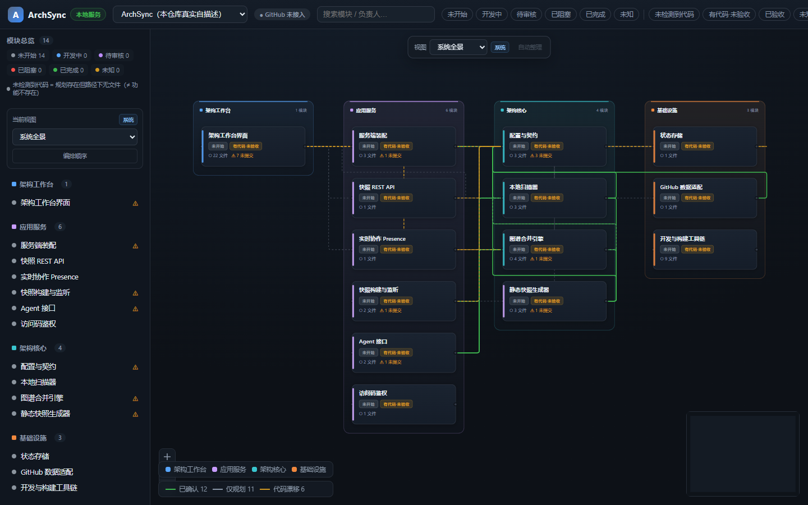
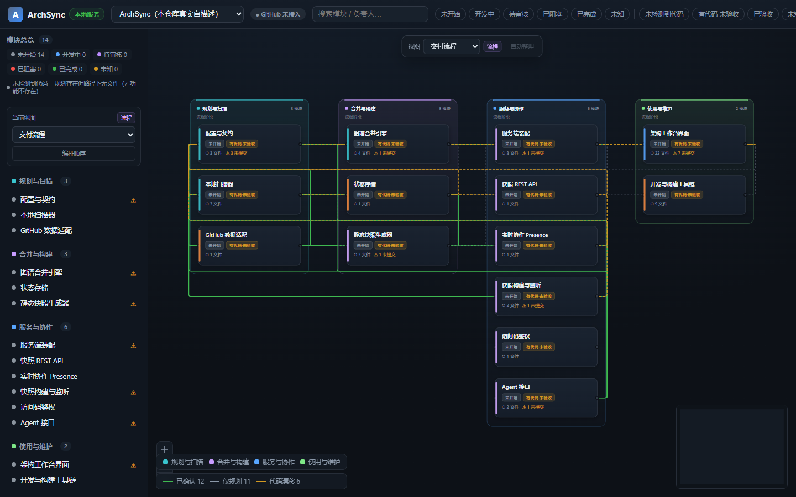

# 项目视图与灵活布局

ArchSync 将**架构事实**和**展示视图**分开：

- `.archsync/project.yaml`：模块、层级和依赖事实。
- `.archsync/views.yaml`：如何分组、按什么顺序展示模块。

视图不会新增、删除或修改模块，也不会改变依赖关系。删除 `views.yaml` 后，ArchSync 会自动按层级生成一个兼容视图。





## views.yaml

```yaml
schemaVersion: 1
defaultView: system-overview

views:
  - id: system-overview
    label: 系统全景
    kind: system          # system | flow | layer
    direction: LR         # LR | TB
    description: 按业务系统组织模块
    groups:
      - id: desktop
        label: 桌面端
        order: 1
        tone: blue        # blue | purple | cyan | orange | green | amber | red | gray
        moduleIds: [workbench-ui]
      - id: backend
        label: 服务端
        order: 2
        tone: purple
        moduleIds: [snapshot-api, presence-ws]
```

规则：

- 同一视图内，每个模块最多出现一次。
- 同一视图内 `group.order` 必须唯一。
- `moduleIds` 必须引用 `project.yaml` 中存在的模块。
- 未分组模块会自动进入“其他模块”，并产生警告。
- `defaultView` 必须引用现有视图；缺省时使用第一个视图。
- `views.yaml` 无效时，项目仍可加载，但会回退到自动层级视图并在快照中显示视图警告。

## Agent 工作流

Agent 不应直接生成像素坐标。分辨率、文本长度和节点数量会变化，硬编码坐标很快失效。推荐的接口是：

```bash
pnpm agent -- layout-context --project archsync
pnpm agent -- layout-validate .archsync/views.yaml --project archsync
```

Agent 根据 `layout-context` 输出 `.archsync/views.yaml`，只决定：

- 使用系统视图、流程图还是技术分层。
- 模块应归入哪些系统或流程阶段。
- 系统顺序、阶段顺序和组内顺序。
- 分组的原因和风险。

坐标由前端确定性布局引擎计算。Agent 产出的视图配置应通过 Git 分支和 PR 审查，不能绕过项目配置的评审流程。

## 前端交互

- 画布顶部可切换项目视图。
- 左侧栏显示当前视图的系统分组。
- “编排顺序”可调整分组和模块顺序。
- 用户级顺序保存在浏览器 `localStorage`，不写回团队配置。
- “自动整理”恢复 `views.yaml` 中的顺序。
- 项目级默认顺序应修改 `views.yaml`，随代码一起审查和发布。

## 兼容与安全

- 旧快照没有 `views` 字段时，前端按层级自动生成视图。
- 视图配置只允许结构化字段，不接受 HTML、CSS 或任意脚本。
- 分组与模块引用经过独立校验；无效配置不会让画布白屏。
- 视图配置参与快照内容哈希，因此团队默认视图变更会产生新快照版本。